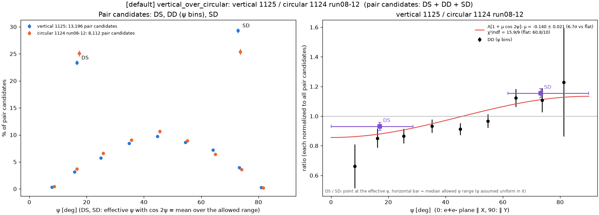
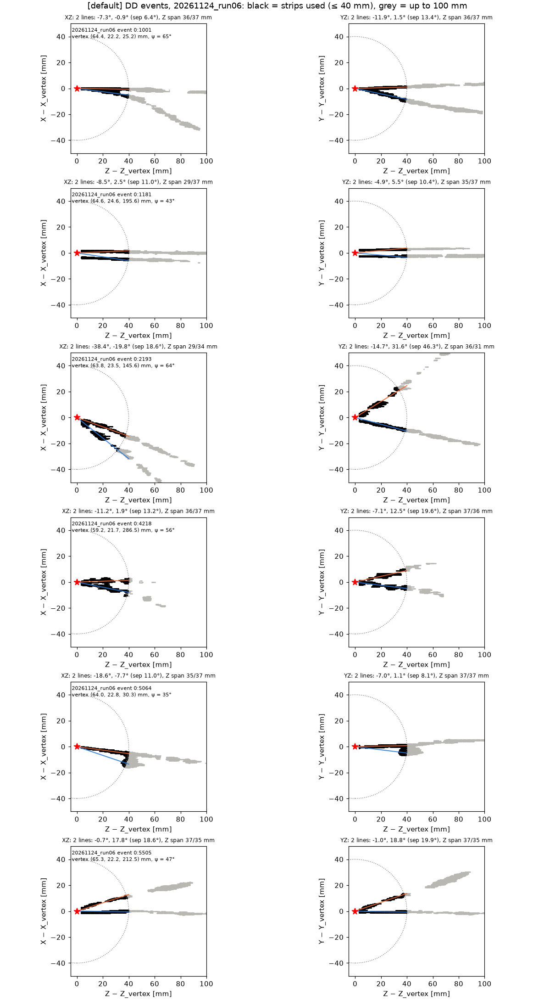
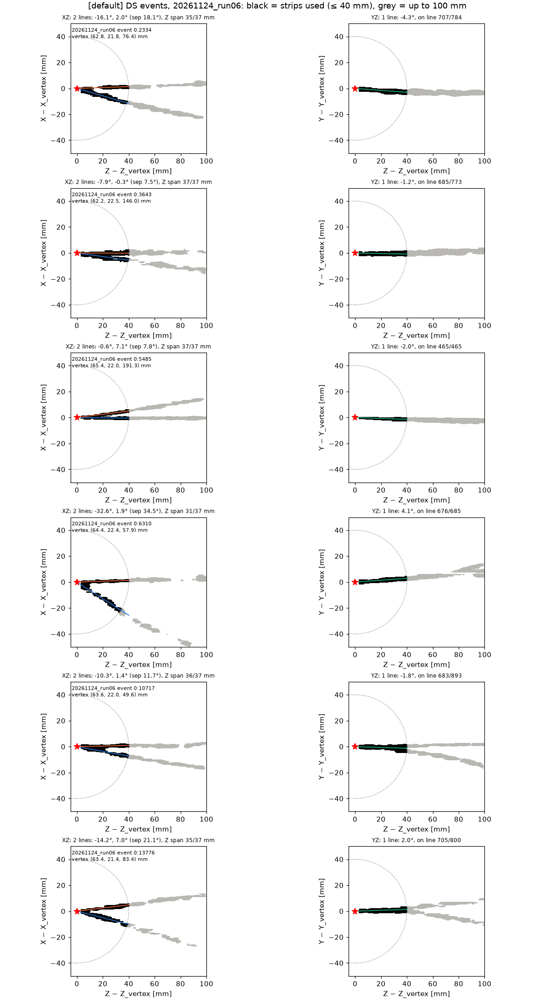

# TPC の飛跡による偏光解析（対生成の2本の枝・1本の飛跡）

UVSOR 6.6 MeV（2026-11-24・25）の水平・垂直・円偏光のデータで、ビーム軸上の散乱点から出る TPC の飛跡の向きを使って偏光を測る。
1本の設定 JSON を読み、`run_pipeline.py` が stage0 から stage5 まで順に実行する。

```bash
cd /home/onoda/analysis_sm3_FM
python3 ETCC_cal/pair_analysis/run_pipeline.py --config ETCC_cal/pair_analysis/config/20261124_25_polarization.json
# 一部のステージ・cut set だけ実行する（stage2 の結果は再利用するので速い）
python3 ETCC_cal/pair_analysis/run_pipeline.py --config ... --stages 3 4 --cut-sets default branch_span15
```

raw は SSD（`/mnt/d/UVSOR2026_late`）から読む。WSL では D: を drvfs でマウントしておく。

## ステージの一覧

上から順に、前のステージの出力を読む。詳しい中身は下の「各ステージ」。

| ステージ | やること | 読むもの | 作るもの | 時間 | やり直しが要るとき |
|---|---|---|---|---|---|
| stage0 入力の確認 | 散乱点 CSV・Z 側除外・raw・ビーム軸がそろっているか確かめる | 既存の ETCC_cal の出力 | `inputs.json` | 数秒 | 毎回（軽い） |
| stage1 散乱点 | 散乱点に Z 側除外の印とビーム軸からの距離を付け、ビーム近くのものを残す | 散乱点 CSV、Z 側除外、ビーム軸 | ランごとの散乱点、件数 `summary.json` | 約30秒 | `scan.beam_radius_mm` を変えたとき（`--rebuild`） |
| stage2 枝の fit | raw TPC を読み、散乱点ごとに XZ・YZ で直線を1本・2本 fit（カットなし） | stage1、raw TPC | ランごとの fit の結果 | 約1時間（全データ・4並列） | `scan` の値・fit のコードを変えたとき、`z_veto: false` の cut set を足したとき（自動で検出） |
| stage3 分類 | cut set のカットをかけ、SS・DS・SD・DD に分類。各カットで残る数を表にする | stage1・stage2 | 分類 `<sample>.npz`、`cutflow.md` | 数秒 | カットを変えたとき |
| stage4 モジュレーション | 比較ごとに、対生成（Q、DS・DD・SD のカーブ、DD だけのカーブ）と1本の飛跡（φ）のモジュレーションと σ | stage3 | 図・JSON、`summary.md` | 数秒 | 比較を変えたとき |
| stage5 イベントの絵 | 分類ごとにイベントを描き、目で確かめる | stage2、raw TPC | PNG | 1分ほど | 見たいラン・分類を変えたとき |

## ファイル

```
pair_analysis/
├── run_pipeline.py              全ステージを順に呼ぶ実行コード（--stages, --cut-sets, --rebuild）
├── config/
│   └── 20261124_25_polarization.json   データセット・カット・比較の設定（説明は _doc に）
├── figures/                     README に載せる代表の図（output からコピー）
└── pipeline/
    ├── config.py                設定の読み込み、cut set の継承（base）、保存先
    ├── track_fit.py             1投影の直線 fit（1本・2本）
    ├── fitting.py               モジュレーションの fit と有意度
    ├── stage0_inputs.py         入力の確認
    ├── stage1_vertices.py       散乱点・Z 側除外・ビーム軸からの距離
    ├── stage2_branch_fit.py     raw TPC を読んで 1本・2本 fit（並列）
    ├── stage3_classify.py       カットと分類、カットの流れの表
    ├── stage4_modulation.py     モジュレーションカーブと有意度
    └── stage5_event_display.py  イベントの絵
```

## 出力（`output_dir` の下）

```
<output_dir>/
├── config_used.json                  実行に使った設定のコピー
├── stage0_inputs/inputs.json         入力ファイルの有無、ランごとの Z 側除外の数
├── stage1_vertices/
│   ├── summary.json                  ランごとのトリガー数・散乱点の数
│   └── <dataset>/<run>.npz           ビーム軸から scan.beam_radius_mm 以内の散乱点
├── stage2_branch_fit/<dataset>/<run>.npz   散乱点ごとの XZ・YZ の 1本 fit・2本 fit（カット前）
├── stage3_classify/<cut_set>/
│   ├── cutflow.md, cutflow.json      各カットで残る数（全トリガーに対する割合も）
│   └── <sample>.npz                  イベントごとの分類・ψ・θ・φ
├── stage4_modulation/<cut_set>/
│   ├── summary.md, summary.json      全比較の結果の表
│   └── <comparison>/pair.png, pair.json            分類の割合・DD の ψ・DD だけのカーブ・Q
│                    pair_curve.png, pair_curve.json  DS・DD・SD をまとめたモジュレーションカーブ
│                    single_track.png, single_track.json  1本の飛跡の φ
└── stage5_event_display/<cut_set>/<run>_<class>_<skip>.png
```

## 結果の図（2026-11-26、cut set `default`）

`figures/` の図は `output_dir` の結果からコピーした代表例（結果のフォルダ自体は Git で追跡しない）。作り直したら必要に応じてコピーし直す。

**DS・DD・SD のモジュレーションカーブ: 水平 ÷ 円偏光**（`stage4_modulation/default/horizontal_over_circular/pair_curve.png`）
μ = +0.141 ± 0.023（6.2σ）、χ²/ndf = 11.0/9。左: 各点の割合、右: 比と fit（紫の四角が DS・SD、横棒は ψ の範囲）。


**同: 垂直 ÷ 円偏光**: μ = −0.140 ± 0.021（6.7σ）。水平と逆向き。



**同じ偏光同士（水平 run00-05 ÷ run06-07）**: μ = −0.030 ± 0.035（0.9σ）。平らなら系統誤差は統計誤差より小さい。


**分類の割合・DD の ψ・DD だけのカーブ・Q: 水平 ÷ 円偏光**（`pair.png`）: DD だけの μ = +0.194 ± 0.043（4.5σ）、ΔQ = +0.103 ± 0.016（6.5σ）。


**イベントの絵（stage5、1124 run06）**: 黒が fit に使ったストリップ（散乱点から 40 mm 以内）、色の線が fit した2本、灰色はその外。
DD（両方の投影で2本）と DS（XZ だけ2本）。





## 各ステージ

**入力**（既存の ETCC_cal の出力。データセットの `etcc_config` に書かれた場所から読む。作り直すときは `prepare_stages.py`）
- 散乱点 CSV（`inputs.vertices_all`）: 同じ uPIC でアノードとカソードがそろう一番早いクロックの点。
- Z 側除外（`outputs.veto_dir/z0_track_veto_<run>.npz`）: Z <= z_veto（15 mm）の raw TPC ヒットを持つイベント。
- ビーム軸（`beam_axis_fit`）: 1124 run06-07 の散乱点から fit した直線。全データで同じものを使う。

**stage0** 入力がそろっているか確かめる。

**stage1** 散乱点（1イベント1つ、CSV で最初の行）に、Z 側除外の印（イベントの Z 側除外か、散乱点の Z <= z_veto）と
ビーム軸からの距離を付け、`scan.beam_radius_mm` 以内のものを保存する。トリガー数は TPC の最大の trig 番号（近似）。

**stage2** raw TPC を読み、散乱点から `scan.radius_mm` 以内・3 mm 以上下流のストリップを XZ と YZ で別々に集め、
散乱点を通る直線を fit する（`track_fit.py`）。
- 1本: 角度を 1° 刻みで投票 → 1.6 mm 以内の点で最小二乗を繰り返す。
- 2本: 投票で1本目、その点を除いて投票で2本目 → 近い方の直線に点を割り当てて fit し直すのを 6 回繰り返す。
  各枝 6 点以上・Z 幅 5 mm 以上・角度差 3° 以上でなければ失敗。
カットはかけずに保存するので、stage3 以降の条件を変えても raw は読み直さない。`scan` の値を変えたときだけ読み直す。

**stage3** cut set ごとに分類する。1本・2本の判定の詳細は下の「1本・2本の判定」を参照。

| 分類 | XZ | YZ | 意味 |
|---|---|---|---|
| SS | 1本 | 1本 | 1本の飛跡（コンプトン電子の候補） |
| DS | 2本 | 1本 | 対生成の候補。e+e- 面がほぼ XZ（ψ ≈ 0°） |
| SD | 1本 | 2本 | 対生成の候補。面がほぼ YZ（ψ ≈ 90°） |
| DD | 2本 | 2本 | 対生成の候補。面の角 ψ を計算 |

「2本」: 角度差 >= `min_separation_deg`、各枝の Z 幅 >= `min_branch_span_mm`、2本に乗ったストリップ >= `min_inlier_fraction`。
「1本」: Z 幅 >= `single_line.min_span_mm`、乗った割合 >= `single_line.min_inlier_fraction`、かつ「2本」でない。
DD の ψ = atan(|Δy'| / |Δx'|)（Δx'・Δy' は各投影での2本の傾きの差）。XZ と YZ の枝の組み方が2通りあって区別できないので、
X 軸で折り返した 0〜90° を使う（偏光が X・Y から 45° 傾いた情報は失われる）。
DS・SD の ψ は1つに決まらないので、とりうる範囲 [psi_lo, psi_hi] を保存する（下の「DS・DD・SD のモジュレーションカーブ」）。

**stage4** 比較（分子 ÷ 分母）ごとに:
- 対生成（3通り。同じ効果を別の方法で見ているので独立ではない）
  - Q = (N_X − N_Y)/(N_X + N_Y)、N_X = DS + DD(ψ<45°)、N_Y = SD + DD(ψ>=45°)。サンプルごとの Q の差 ΔQ とその σ。
    Q 自体には検出器の XZ・YZ の効率の差も入るので、データ同士の差 ΔQ を見る。
  - DS・DD・SD のカーブ（`pair_curve.png`）: 11 点で A[1 + μ c_k] を fit（下の節）。対生成の候補を全部使う。
  - DD だけのカーブ（`pair.png`）: DD の ψ のヒストグラムの比を A[1 + μ cos 2ψ] で fit。ψ が決まるイベントだけなので、
    μ はなまらないがイベントは少ない。
  - σ はどれも統計誤差だけ。カーブは平らな線との Δχ²（1自由度）から出す。
- 1本の飛跡（SS）: θ >= θmin ごとに φ のヒストグラムの比を A[1 + μ cos 2(φ − φ0)] で fit（2自由度）。

**stage5** `event_display` で指定したランの、分類ごとの先頭のイベントを描く（黒: fit に使ったストリップ、灰色: その外）。

## DS・DD・SD のモジュレーションカーブ

**ψ の範囲**（stage3 の `psi_range`）
- DD: ψ = atan(|Δy'| / |Δx'|) に決まる。
- DS: YZ では1本に見えたので、YZ での2本の傾きの差は tan(`min_separation_deg`) より小さいとみなす。
  ψ は 0 から ψ_max = atan(tan(`min_separation_deg`) / |Δx'|)（45° を上限）の間。
- SD: 同様に ψ は 90° − atan(tan(`min_separation_deg`) / |Δy'|) から 90° の間。

**カーブ**（stage4 の `pair_curve_result`）
1. 点は DS、DD の ψ の各ビン（`analysis.pair.psi_bins`、既定 9）、SD の 11 点。
2. 各サンプルで、点ごとの数を対生成の候補の総数（DS + SD + DD）で割り、分子 ÷ 分母の比を取る（アクセプタンスが消える）。
3. 点ごとに cos 2ψ の平均 c_k を出す。DS・SD は範囲内で ψ が一様と仮定し、イベントごとに
   (sin 2ψ_hi − sin 2ψ_lo) / (2(ψ_hi − ψ_lo)) を出して平均する。DD のビンはビン内の cos 2ψ の平均。2つのサンプルを合わせて計算する。
4. 比を A[1 + μ c_k] で fit する。μ > 0 なら e+e- 面が X に近いものが分子で多い。
5. 図の横軸: 点は cos 2ψ_eff = c_k となる ψ_eff に置き、DS・SD の横棒は ψ の範囲（中央値）。

**注意**
- DS・SD の ψ が範囲内で一様という仮定は近似。範囲の端に寄っていると c_k がずれ、μ が少し変わる。
- DS・SD は ψ が範囲でしかわからないのでカーブの両端がなまり、μ は DD だけの fit より小さく出る。
  代わりにイベントが倍近くになるので、σ は大きくなる。

## `etcc_config`（データセットごとの既存の ETCC_cal 設定）

`datasets.<名前>.etcc_config` は、ETCC_cal で前から使っている解析の設定ファイル（例: `ETCC_cal/config/20261124_run00_07_horizontal.json`）へのパス。
raw の場所や較正の値を二重に書かないように、そこから次の項目だけを読む。それ以外（`runs`、`result_dir`、`polarization` など）は使わない。
ランは、このパイプラインの設定の `datasets.<名前>.runs` を使う。

| 項目 | 中身（水平の例） | 使うところ |
|---|---|---|
| `data_root` | `/mnt/d/UVSOR2026_late` | raw TPC の場所（stage0・2・5） |
| `storages` | `["calltt", "killua"]` | アノード・カソードの raw のフォルダ（`data_root/<storage>/<run>`） |
| `velocity` | 0.39358 mm/clock | ドリフト速度。Z = velocity × (clock − clock_offset) + z_gem |
| `clock_offset` | 133.69 clock | GEM の面に当たるクロック |
| `z_gem` | 5.0 mm | GEM の面の Z |
| `pitch_strip` | 0.4 mm | ストリップの間隔（raw を読む `scan_run` が使う） |
| `z_veto` | 15.0 mm | Z 側除外の基準。散乱点の Z もこれと比べる |
| `inputs.vertices_all` | `ETCC_cal/output/20261124_run00_07/without_z0_cut/vertices/all.csv` | 散乱点 CSV（stage1） |
| `outputs.veto_dir` | `ETCC_cal/output/20261124_run00_07/shared/selection` | Z 側除外のイベント一覧 `z0_track_veto_<run>.npz` の場所（stage0・1） |

今の設定で使っているもの:

| データセット | `etcc_config` |
|---|---|
| horizontal | `ETCC_cal/config/20261124_run00_07_horizontal.json` |
| circular | `ETCC_cal/config/20261124_run08_12_circular.json` |
| vertical | `ETCC_cal/config/20261125_vertical.json` |

較正の値（`velocity`・`clock_offset`・`z_gem`）は3つとも同じ。違うのは散乱点 CSV と Z 側除外の場所。

## 1本・2本の判定

投影（XZ か YZ）ごとに、1本と2本の両方を fit し（stage2、`track_fit.py`）、後で cut set の値で判定する（stage3、`stage3_classify.projection_flags`）。

**fit（stage2、カットなし）**
使う点は、散乱点から `scan.radius_mm` 以内・3 mm 以上下流のストリップ（1点 = あるクロックで鳴った1本のストリップ）。
座標は散乱点を原点にした (dz, t)（t は X か Y）。直線は散乱点を通る t = slope·dz で、直線から 1.6 mm 以内の点を「乗った点」とする。

- 1本: 角度を −85〜+85° で 1° 刻みに振り、乗る点が一番多い角度を選ぶ（投票）→ 乗った点で最小二乗 fit して乗る点を選び直す（5回）。
  乗った点が 6 個未満なら失敗。傾き・乗った点の数・全点数・乗った点の Z 幅を保存。
- 2本（点が 12 個以上のときだけ試す）:
  1. 0.5° 刻みの投票で1本目の角度を決める。
  2. 1本目に乗った点を除き、もう一度投票して2本目の角度を決める。
  3. 各点を近い方の直線に割り当て（1.6 mm より遠い点はどちらにも入れない）、それぞれ最小二乗 fit し直す（6回）。
  4. 途中で枝の点が 6 個未満か Z 幅が 5 mm 未満になったら失敗。最後に角度差が 3° 未満でも失敗。
  2本それぞれの傾き・点の数・Z 幅を保存。

**判定（stage3、2本を先に見る）**

| 判定 | 条件 |
|---|---|
| 2本 | 2本 fit が成立し、角度差 >= `two_branch.min_separation_deg`、各枝の Z 幅 >= `two_branch.min_branch_span_mm`、(n0 + n1)/全点数 >= `two_branch.min_inlier_fraction` |
| 1本 | 「2本」でなく、1本 fit が成立し、Z 幅 >= `single_line.min_span_mm`、乗った点/全点数 >= `single_line.min_inlier_fraction` |
| どちらでもない | 上のどちらも満たさない |

「乗った割合」は、その投影で使った全点のうち、直線（2本なら近い方の直線）から 1.6 mm 以内にある点の割合。
3本目の飛跡・δ 線・散乱点のかたまり・大きく曲がった飛跡・ノイズがあると下がる。
2本 fit は投票で一番多く乗る2本を探すので、飛跡が何本あっても2本は見つかってしまう。この割合でそういうイベントを落とす。

**2つの投影の組み合わせ**

| XZ \ YZ | 2本 | 1本 | どちらでもない |
|---|---|---|---|
| 2本 | DD | DS | 使わない |
| 1本 | SD | SS | 使わない |
| どちらでもない | 使わない | 使わない | 使わない |

**考え方と弱いところ**
- 2本を先に判定するのは、開き角の小さい対生成でも、1本の条件（70% 以上が1本に乗る）を満たしてしまうことがあるから。
- 2本 fit は、1本の曲がった飛跡の手前と奥を別々の直線で拾うことがある。各枝の Z 幅の下限（既定 25 mm）は、
  2本とも散乱点から十分遠くまで伸びていることを求めて、この偽物を落とすための条件（stage5 の絵で確認）。
- 角度差が `min_separation_deg` 未満の対生成は、その投影では1本になる（DS・SD、両方なら SS に入る）。
- 判定は点の数と乗った割合だけで、電荷や飛跡の太さは使っていない。

## カットの組み合わせ

`cut_sets` に名前を付けて並べる。`base` で別の組を継承し、変えるところだけ書く。

```json
"default": {"z_veto": true, "beam_radius_mm": 5.0,
            "single_line": {"min_span_mm": 10.0, "min_inlier_fraction": 0.7},
            "two_branch": {"min_separation_deg": 6.0, "min_branch_span_mm": 25.0, "min_inlier_fraction": 0.7}},
"branch_span15": {"base": "default", "two_branch": {"min_branch_span_mm": 15.0}}
```

- `beam_radius_mm` は `scan.beam_radius_mm` 以下。
- `z_veto: false` の cut set を加えると、stage2 が Z 側除外にかかったイベントも読むように自動で切り替わり、やり直しになる（読む量が約3倍）。
  除外ありとなしの cut set を並べれば、同じ fit の結果から比べられる。
- サンプル（ランの部分集合）は `samples` に定義し、`comparisons` で分子・分母に使える。

## 注意

- 有意度は統計誤差だけ。同じ偏光同士の比較（`null_...`）で、系統誤差が統計誤差より大きくないかを確かめる。
- 検出器の X・Y と実験室の水平・垂直の対応は未確認（対生成では e+e- 面が偏光の向きに沿う傾向があるので、
  水平で ψ ≈ 0° が多ければ X ≈ 水平）。
- 旧スクリプト（`tpc_electron_modulation.py`、`tpc_pair_modulation.py`、`plot_pair_candidates.py`）は同じ解析の試作版。
  このパイプラインと分類の結果は一致する（2026-11-26 に 1124 run00・run03 で確認）。1本の飛跡の解析は、旧版は半径 30 mm で
  1本 fit の条件だけだったが、ここでは半径 `scan.radius_mm` で SS（2本に見えないもの）に限っている。
