# TPC の飛跡による偏光解析（対生成の2本の枝・1本の飛跡）

UVSOR 6.6 MeV（2026-11-24・25）の水平・垂直・円偏光のデータで、ビーム軸上の散乱点から出る TPC の飛跡の向きを使って偏光を測る。
1本の設定 JSON を読み、`run_pipeline.py` が stage0 から stage5 まで順に実行する。

```bash
cd /home/onoda/analysis_sm3_FM
python3 ETCC_cal/pair_analysis/run_pipeline.py --config ETCC_cal/pair_analysis/config/20261124_25_polarization.json
# 一部のステージ・cut set だけ実行する（stage2 の結果は再利用するので速い）
python3 ETCC_cal/pair_analysis/run_pipeline.py --config ... --stages 3 4 --cut-sets default branch_span15
```

raw は SSD（`/mnt/d/UVSOR2026_late`）から読む。WSL では D: を drvfs でマウントしておく。

## ステージの一覧

上から順に、前のステージの出力を読む。詳しい中身は下の「各ステージ」。

| ステージ | やること | 読むもの | 作るもの | 時間 | やり直しが要るとき |
|---|---|---|---|---|---|
| stage0 入力の確認 | 散乱点 CSV・Z 側除外・raw・ビーム軸がそろっているか確かめる | 既存の ETCC_cal の出力 | `inputs.json` | 数秒 | 毎回（軽い） |
| stage1 散乱点 | 散乱点に Z 側除外の印とビーム軸からの距離を付け、ビーム近くのものを残す | 散乱点 CSV、Z 側除外、ビーム軸 | ランごとの散乱点、件数 `summary.json` | 約30秒 | `scan.beam_radius_mm` を変えたとき（`--rebuild`） |
| stage2 枝の fit | raw TPC を読み、散乱点ごとに XZ・YZ で直線を1本・2本 fit（カットなし）。`pairing.enabled` なら、もう一度読んで2本の枝を下流まで追う | stage1、raw TPC | ランごとの fit の結果、組み方の材料 `<run>_pairing.npz` | 約1時間（全データ・4並列） | `scan` の値・fit のコードを変えたとき、`z_veto: false` の cut set を足したとき（自動で検出） |
| stage3 分類 | cut set のカットをかけ、SS・DS・SD・DD に分類。DD の枝の組み方を決めて面の方位角 φ_pair（0〜180°）を出す。各カットで残る数を表にする | stage1・stage2 | 分類 `<sample>.npz`、`cutflow.md` | 数秒 | カットを変えたとき |
| stage4 モジュレーション | 比較ごとに、対生成（Q、DD の ψ のカーブ、組み方を決めた DD の φ_pair のカーブ。DS・SD は参照点）と1本の飛跡（φ）のモジュレーションと σ | stage3 | 図・JSON、`summary.md` | 数秒 | 比較を変えたとき |
| stage5 イベントの絵 | 分類ごとにイベントを描き、目で確かめる | stage2、raw TPC | PNG | 1分ほど | 見たいラン・分類を変えたとき |

## ファイル

```
pair_analysis/
├── run_pipeline.py              全ステージを順に呼ぶ実行コード（--stages, --cut-sets, --rebuild）
├── config/
│   └── 20261124_25_polarization.json   データセット・カット・比較の設定（説明は _doc に）
├── make_schematic.py            README の模式図（figures/pairing_schematic.png）を作る
├── make_pairing_stats.py        README の相関係数の分布（figures/pairing_correlation.png）と数値を作る
├── make_cluster_figure.py       README の塊と範囲の説明の図（figures/pairing_clusters.png, pairing_ranges.png）を作る（raw を読む）
├── figures/                     README に載せる代表の図（output からコピー）
└── pipeline/
    ├── config.py                設定の読み込み、cut set の継承（base）、保存先
    ├── track_fit.py             1投影の直線 fit（1本・2本）
    ├── fitting.py               モジュレーションの fit と有意度
    ├── stage0_inputs.py         入力の確認
    ├── stage1_vertices.py       散乱点・Z 側除外・ビーム軸からの距離
    ├── stage2_branch_fit.py     raw TPC を読んで 1本・2本 fit（並列）
    ├── stage3_classify.py       カットと分類、カットの流れの表
    ├── stage4_modulation.py     モジュレーションカーブと有意度
    ├── branch_pairing.py        XZ・YZ の枝の組み方（枝を追う・相関・端の Z・決め方）
    └── stage5_event_display.py  イベントの絵、枝を追った様子
```

## 出力（`output_dir` の下）

```
<output_dir>/
├── config_used.json                  実行に使った設定のコピー
├── stage0_inputs/inputs.json         入力ファイルの有無、ランごとの Z 側除外の数
├── stage1_vertices/
│   ├── summary.json                  ランごとのトリガー数・散乱点の数
│   └── <dataset>/<run>.npz           ビーム軸から scan.beam_radius_mm 以内の散乱点
├── stage2_branch_fit/<dataset>/<run>.npz   散乱点ごとの XZ・YZ の 1本 fit・2本 fit（カット前）
│                     <run>_pairing.npz    XZ・YZ の枝の組み方の材料（相関・端の Z、末尾の節）
├── stage3_classify/<cut_set>/
│   ├── cutflow.md, cutflow.json      各カットで残る数（全トリガーに対する割合も）
│   └── <sample>.npz                  イベントごとの分類・ψ・θ・φ
├── stage4_modulation/<cut_set>/
│   ├── summary.md, summary.json      全比較の結果の表
│   ├── overview.png, overview.json   全体図（analysis.overview のサンプルを重ね、基準に対する比）
│   └── <comparison>/pair.png, pair.json            分類の割合・DD の ψ・DD だけのカーブ・Q
│                    pair_curve.png, pair_curve.json  DS・DD・SD の比（fit は DD だけ、DS・SD は参照点）
│                    pair_phi.png, pair_phi.json      組み方を決めた DD の φ_pair（0〜180°）の比と fit（φ0 も自由）
│                    single_track.png, single_track.json  1本の飛跡の φ
└── stage5_event_display/<cut_set>/<run>_<class>_<skip>.png
```

## 結果の図（2026-11-26、cut set `default`）

`figures/` の図は `output_dir` の結果からコピーした代表例（結果のフォルダ自体は Git で追跡しない）。作り直したら必要に応じてコピーし直す。

**全体図: 水平・垂直・円偏光**（`stage4_modulation/default/overview.png`、設定の `analysis.overview`）
左: 各データの DS・DD（ψ のビン）・SD の割合。右: 円偏光に対する比。線は DD の点だけで fit したもの
（水平 μ = +0.199 ± 0.044、垂直 μ = −0.166 ± 0.039）。白抜きの四角は DS・SD（ψ が範囲でしかわからないので fit に使わない参考の点）。
水平は面が X（ψ ≈ 0°）に、垂直は Y（ψ ≈ 90°）に寄り、カーブが逆向きになる。

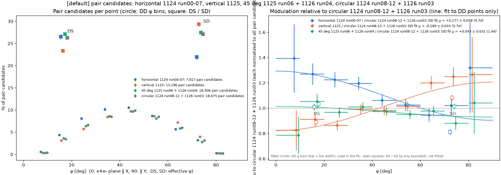

**モジュレーションカーブ: 水平 ÷ 円偏光**（`stage4_modulation/default/horizontal_over_circular/pair_curve.png`）
DD の点だけの fit: μ = +0.198 ± 0.044（4.5σ）、χ²/ndf = 3.6/7。左: 各点の割合、右: 比と fit。
白抜きの紫の四角は DS・SD の参照点（fit に使わない。横棒は ψ のとりうる範囲）。

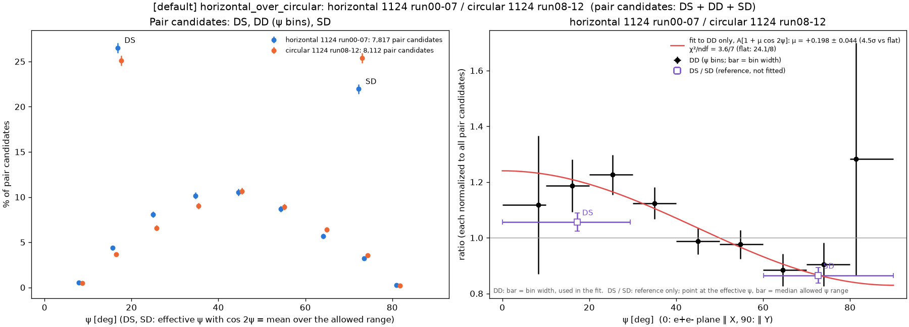

**同: 垂直 ÷ 円偏光**: DD の fit で μ = −0.167 ± 0.039（4.2σ）、χ²/ndf = 5.0/7。水平と逆向き。


**同じ偏光同士（水平 run00-05 ÷ run06-07）**: DD の fit で μ = +0.031 ± 0.064（0.5σ）。平らなので、系統誤差は統計誤差より小さい。

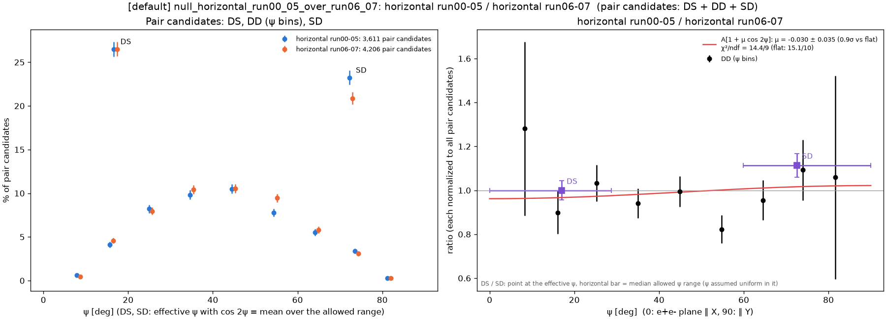

**分類の割合・DD の ψ・DD だけのカーブ・Q: 水平 ÷ 円偏光**（`pair.png`）: DD だけの μ = +0.194 ± 0.043（4.5σ）、ΔQ = +0.103 ± 0.016（6.5σ）。

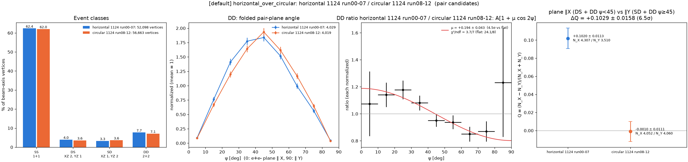

**イベントの絵（stage5、1124 run06）**: 黒が fit に使ったストリップ（散乱点から 40 mm 以内）、色の線が fit した2本、灰色はその外。
DD（両方の投影で2本）と DS（XZ だけ2本）。


## 各ステージ

**入力**（既存の ETCC_cal の出力。データセットの `etcc_config` に書かれた場所から読む。作り直すときは `prepare_stages.py`）
- 散乱点 CSV（`inputs.vertices_all`）: 同じ uPIC でアノードとカソードがそろう一番早いクロックの点。
- Z 側除外（`outputs.veto_dir/z0_track_veto_<run>.npz`）: Z <= z_veto（15 mm）の raw TPC ヒットを持つイベント。
- ビーム軸（`beam_axis_fit`）: 1124 run06-07 の散乱点から fit した直線。全データで同じものを使う。

**stage0** 入力がそろっているか確かめる。

**stage1** 散乱点（1イベント1つ、CSV で最初の行）に、Z 側除外の印（イベントの Z 側除外か、散乱点の Z <= z_veto）と
ビーム軸からの距離を付け、`scan.beam_radius_mm` 以内のものを保存する。トリガー数は TPC の最大の trig 番号（近似）。

**stage2** raw TPC を読み、散乱点から `scan.radius_mm` 以内・3 mm 以上下流のストリップを XZ と YZ で別々に集め、
散乱点を通る直線を fit する（`track_fit.py`）。
- 1本: 角度を 1° 刻みで投票 → 1.6 mm 以内の点で最小二乗を繰り返す。
- 2本: 投票で1本目、その点を除いて投票で2本目 → 近い方の直線に点を割り当てて fit し直すのを 6 回繰り返す。
  各枝 6 点以上・Z 幅 5 mm 以上・角度差 3° 以上でなければ失敗。
カットはかけずに保存するので、stage3 以降の条件を変えても raw は読み直さない。`scan` の値を変えたときだけ読み直す。

**stage3** cut set ごとに分類する。1本・2本の判定の詳細は下の「1本・2本の判定」を参照。

| 分類 | XZ | YZ | 意味 |
|---|---|---|---|
| SS | 1本 | 1本 | 1本の飛跡（コンプトン電子の候補） |
| DS | 2本 | 1本 | 対生成の候補。e+e- 面がほぼ XZ（ψ ≈ 0°） |
| SD | 1本 | 2本 | 対生成の候補。面がほぼ YZ（ψ ≈ 90°） |
| DD | 2本 | 2本 | 対生成の候補。面の角 ψ を計算 |

「2本」: 角度差 >= `min_separation_deg`、各枝の Z 幅 >= `min_branch_span_mm`、2本に乗ったストリップ >= `min_inlier_fraction`。
「1本」: Z 幅 >= `single_line.min_span_mm`、乗った割合 >= `single_line.min_inlier_fraction`、かつ「2本」でない。
DD の ψ = atan(|Δy'| / |Δx'|)（Δx'・Δy' は各投影での2本の傾きの差）。XZ と YZ の枝の組み方が2通りあって区別できないので、
X 軸で折り返した 0〜90° を使う（偏光が X・Y から 45° 傾いた情報は失われる）。
DS・SD の ψ は1つに決まらないので、とりうる範囲 [psi_lo, psi_hi] を保存する（下の「DS・DD・SD のモジュレーションカーブ」）。

**stage4** 比較（分子 ÷ 分母）ごとに:
- 対生成（3通り。同じ効果を別の方法で見ているので独立ではない）
  - Q = (N_X − N_Y)/(N_X + N_Y)、N_X = DS + DD(ψ<45°)、N_Y = SD + DD(ψ>=45°)。サンプルごとの Q の差 ΔQ とその σ。
    Q 自体には検出器の XZ・YZ の効率の差も入るので、データ同士の差 ΔQ を見る。
  - DD の ψ のカーブ（主な結果）: DD の ψ のヒストグラムの比を A[1 + μ cos 2ψ] で fit。`pair.png` は DD の総数で、
    `pair_curve.png` と全体図は対生成の候補の総数で規格化している（μ はほぼ同じ）。
  - DS・SD は `pair_curve.png` と全体図に参照点として描くだけで、fit には使わない（下の節）。
  - σ はどれも統計誤差だけ。カーブは平らな線との Δχ²（1自由度）から出す。
- 1本の飛跡（SS）: θ >= θmin ごとに φ のヒストグラムの比を A[1 + μ cos 2(φ − φ0)] で fit（2自由度）。

**stage5** `event_display` で指定したランの、分類ごとの先頭のイベントを描く（黒: fit に使ったストリップ、灰色: その外）。

## DS・DD・SD のモジュレーションカーブ

**ψ の範囲**（stage3 の `psi_range`）
- DD: ψ = atan(|Δy'| / |Δx'|) に決まる。
- DS: YZ では1本に見えたので、YZ での2本の傾きの差は tan(`min_separation_deg`) より小さいとみなす。
  ψ は 0 から ψ_max = atan(tan(`min_separation_deg`) / |Δx'|)（45° を上限）の間。
- SD: 同様に ψ は 90° − atan(tan(`min_separation_deg`) / |Δy'|) から 90° の間。

**図**（stage4 の `pair_curve_result`）
1. 点は DS、DD の ψ の各ビン（`analysis.pair.psi_bins`、既定 9）、SD の 11 点。
2. 各サンプルで、点ごとの数を対生成の候補の総数（DS + SD + DD）で割り、分子 ÷ 分母の比を取る（アクセプタンスが消える）。
3. 点ごとに cos 2ψ の平均 c_k を出す。DS・SD は範囲内で ψ が一様と仮定し、イベントごとに
   (sin 2ψ_hi − sin 2ψ_lo) / (2(ψ_hi − ψ_lo)) を出して平均する。DD のビンはビン内の cos 2ψ の平均。2つのサンプルを合わせて計算する。
4. **DD の点だけ**を A[1 + μ c_k] で fit する（主な結果）。μ > 0 なら e+e- 面が X に近いものが分子で多い。
   DS・SD は参照点で fit に使わない。
5. 参考として、DS・SD も入れた 11 点の fit を `pair_curve.json` の `fit_all_points_reference` と summary に残す。
6. 図の横軸: 点は cos 2ψ_eff = c_k となる ψ_eff に置き、DS・SD の横棒は ψ のとりうる範囲（中央値）。

**DS・SD を fit に使わない理由**
- DS・SD のモジュレーションは、DD のカーブから予想される値の約 0.65 倍しかない（水平・垂直とも同じ向き）。
  11 点で fit すると合わない（水平 ÷ 円偏光 χ²/ndf = 11.0/9、垂直 ÷ 円偏光 15.9/9、水平 ÷ 垂直 36.9/9）。
- 原因の候補: 「1本」と判定された投影が、いつも角度差 6° 未満の2本とは限らない。角度差は 6° 以上でも、
  各枝の Z 幅や乗った割合のカットで「2本」を落ち、1本の条件を通ったイベントが混ざると、ψ の範囲の見積もりが成り立たない。
- 未解決（2026-11-26 に後回し）。確かめるには、stage2 の結果で「1本」側の2本 fit を集計する（raw の読み直しは不要）。

## `etcc_config`（データセットごとの既存の ETCC_cal 設定）

`datasets.<名前>.etcc_config` は、ETCC_cal で前から使っている解析の設定ファイル（例: `ETCC_cal/config/20261124_run00_07_horizontal.json`）へのパス。
raw の場所や較正の値を二重に書かないように、そこから次の項目だけを読む。それ以外（`runs`、`result_dir`、`polarization` など）は使わない。
ランは、このパイプラインの設定の `datasets.<名前>.runs` を使う。

| 項目 | 中身（水平の例） | 使うところ |
|---|---|---|
| `data_root` | `/mnt/d/UVSOR2026_late` | raw TPC の場所（stage0・2・5） |
| `storages` | `["calltt", "killua"]` | アノード・カソードの raw のフォルダ（`data_root/<storage>/<run>`） |
| `velocity` | 0.39358 mm/clock | ドリフト速度。Z = velocity × (clock − clock_offset) + z_gem |
| `clock_offset` | 133.69 clock | GEM の面に当たるクロック |
| `z_gem` | 5.0 mm | GEM の面の Z |
| `pitch_strip` | 0.4 mm | ストリップの間隔（raw を読む `scan_run` が使う） |
| `z_veto` | 15.0 mm | Z 側除外の基準。散乱点の Z もこれと比べる |
| `inputs.vertices_all` | `ETCC_cal/output/20261124_run00_07/without_z0_cut/vertices/all.csv` | 散乱点 CSV（stage1） |
| `outputs.veto_dir` | `ETCC_cal/output/20261124_run00_07/shared/selection` | Z 側除外のイベント一覧 `z0_track_veto_<run>.npz` の場所（stage0・1） |

今の設定で使っているもの:

| データセット | `etcc_config` |
|---|---|
| horizontal | `ETCC_cal/config/20261124_run00_07_horizontal.json` |
| circular | `ETCC_cal/config/20261124_run08_12_circular.json` |
| vertical | `ETCC_cal/config/20261125_vertical.json` |

較正の値（`velocity`・`clock_offset`・`z_gem`）は3つとも同じ。違うのは散乱点 CSV と Z 側除外の場所。

## 1本・2本の判定

投影（XZ か YZ）ごとに、1本と2本の両方を fit し（stage2、`track_fit.py`）、後で cut set の値で判定する（stage3、`stage3_classify.projection_flags`）。

**fit（stage2、カットなし）**
使う点は、散乱点から `scan.radius_mm` 以内・3 mm 以上下流のストリップ（1点 = あるクロックで鳴った1本のストリップ）。
座標は散乱点を原点にした (dz, t)（t は X か Y）。直線は散乱点を通る t = slope·dz で、直線から 1.6 mm 以内の点を「乗った点」とする。

- 1本: 角度を −85〜+85° で 1° 刻みに振り、乗る点が一番多い角度を選ぶ（投票）→ 乗った点で最小二乗 fit して乗る点を選び直す（5回）。
  乗った点が 6 個未満なら失敗。傾き・乗った点の数・全点数・乗った点の Z 幅を保存。
- 2本（点が 12 個以上のときだけ試す）:
  1. 0.5° 刻みの投票で1本目の角度を決める。
  2. 1本目に乗った点を除き、もう一度投票して2本目の角度を決める。
  3. 各点を近い方の直線に割り当て（1.6 mm より遠い点はどちらにも入れない）、それぞれ最小二乗 fit し直す（6回）。
  4. 途中で枝の点が 6 個未満か Z 幅が 5 mm 未満になったら失敗。最後に角度差が 3° 未満でも失敗。
  2本それぞれの傾き・点の数・Z 幅を保存。

**なぜ割り当てと fit を繰り返すか**（直線版の k-means と同じ考え方）

投票で決めた最初の2本には、次の問題がある。
- 角度が粗い: 0.5° 刻みの中から「1.6 mm 以内に何点乗るか」で選ぶので、最小二乗の最適な角度ともずれる。
- 1本目が点を取りすぎる: 散乱点の近くでは2本が重なり、2本目の点も1本目に乗る（開き角 6° なら散乱点から約 15 mm、
  10° なら約 9 mm まで2本の間隔が 1.6 mm より狭い）。2本目はその点を除いた残り（散乱点から遠い部分）だけで決まり、
  1本目は2本目の点を巻き込んだ分だけ2本目の側に傾く。

繰り返しでは、(1) 各点を今の2本のうち近い方に割り当て、(2) それぞれの点の集まりで散乱点を通る直線を最小二乗で fit し直す。
直線が動くと境目近くの点の割り当てが変わるので、これを繰り返して、割り当てと直線が互いに矛盾しない状態に近づける。
各枝の点の数と Z 幅も、この割り当てから数える（stage3 の「各枝の Z 幅」のカットはこれを使う）。

**「近い方」の定義**: 投影の平面（Z と X、または Z と Y）の上で、点 (dz, t) から直線（散乱点を通り Z 軸から角度 a）に下ろした
垂線の長さ d = |t·cos a − dz·sin a| が短い方（`track_fit._distance`）。3D の距離ではない。
- d₀ <= d₁ かつ d₀ <= 1.6 mm なら枝 0、d₁ < d₀ かつ d₁ <= 1.6 mm なら枝 1（同じ距離なら、1本目に見つけた枝 0）。
- どちらも 1.6 mm より遠い点はどちらにも入れない（fit に使わず、「乗った割合」の分母にだけ入る）。
- 散乱点の近くでは2本の間隔が狭く、わずかな距離の差で振り分けが決まる。ただし直線は散乱点を通るので、角度は主に遠い点で決まり、
  近くの点の振り分けはあまり効かない。

**繰り返しの回数（6回）について**: 根拠のある値ではない（試作の `tpc_projected_pair.py` の 5 回をもとにした）。
収束の判定は入れておらず、6回で打ち切る。ふつうは 2〜3 回で割り当てが変わらなくなると考えているが、確かめていない。
確かめるには、回ごとに割り当てが変わった点の数を記録するか、「変わらなくなったら止める」判定を入れて結果を比べる（raw の読み直しが要る）。

**判定（stage3、2本を先に見る）**

| 判定 | 条件 |
|---|---|
| 2本 | 2本 fit が成立し、角度差 >= `two_branch.min_separation_deg`、各枝の Z 幅 >= `two_branch.min_branch_span_mm`、(n0 + n1)/全点数 >= `two_branch.min_inlier_fraction` |
| 1本 | 「2本」でなく、1本 fit が成立し、Z 幅 >= `single_line.min_span_mm`、乗った点/全点数 >= `single_line.min_inlier_fraction` |
| どちらでもない | 上のどちらも満たさない |

「乗った割合」は、その投影で使った全点のうち、直線（2本なら近い方の直線）から 1.6 mm 以内にある点の割合。
3本目の飛跡・δ 線・散乱点のかたまり・大きく曲がった飛跡・ノイズがあると下がる。
2本 fit は投票で一番多く乗る2本を探すので、飛跡が何本あっても2本は見つかってしまう。この割合でそういうイベントを落とす。

**2つの投影の組み合わせ**

| XZ \ YZ | 2本 | 1本 | どちらでもない |
|---|---|---|---|
| 2本 | DD | DS | 使わない |
| 1本 | SD | SS | 使わない |
| どちらでもない | 使わない | 使わない | 使わない |

**考え方と弱いところ**
- 2本を先に判定するのは、開き角の小さい対生成でも、1本の条件（70% 以上が1本に乗る）を満たしてしまうことがあるから。
- 2本 fit は、1本の曲がった飛跡の手前と奥を別々の直線で拾うことがある。各枝の Z 幅の下限（既定 25 mm）は、
  2本とも散乱点から十分遠くまで伸びていることを求めて、この偽物を落とすための条件（stage5 の絵で確認）。
- 角度差が `min_separation_deg` 未満の対生成は、その投影では1本になる（DS・SD、両方なら SS に入る）。
- 判定は点の数と乗った割合だけで、電荷や飛跡の太さは使っていない。

## カットの組み合わせ

`cut_sets` に名前を付けて並べる。`base` で別の組を継承し、変えるところだけ書く。

```json
"default": {"z_veto": true, "beam_radius_mm": 5.0,
            "single_line": {"min_span_mm": 10.0, "min_inlier_fraction": 0.7},
            "two_branch": {"min_separation_deg": 6.0, "min_branch_span_mm": 25.0, "min_inlier_fraction": 0.7}},
"branch_span15": {"base": "default", "two_branch": {"min_branch_span_mm": 15.0}}
```

- `beam_radius_mm` は `scan.beam_radius_mm` 以下。
- `z_veto: false` の cut set を加えると、stage2 が Z 側除外にかかったイベントも読むように自動で切り替わり、やり直しになる（読む量が約3倍）。
  除外ありとなしの cut set を並べれば、同じ fit の結果から比べられる。
- サンプル（ランの部分集合）は `samples` に定義し、`comparisons` で分子・分母に使える。

## 注意

- 有意度は統計誤差だけ。同じ偏光同士の比較（`null_...`）で、系統誤差が統計誤差より大きくないかを確かめる。
- 検出器の X・Y と実験室の水平・垂直の対応は未確認（対生成では e+e- 面が偏光の向きに沿う傾向があるので、
  水平で ψ ≈ 0° が多ければ X ≈ 水平）。
- 旧スクリプト（`tpc_electron_modulation.py`、`tpc_pair_modulation.py`、`plot_pair_candidates.py`）は同じ解析の試作版。
  このパイプラインと分類の結果は一致する（2026-11-26 に 1124 run00・run03 で確認）。1本の飛跡の解析は、旧版は半径 30 mm で
  1本 fit の条件だけだったが、ここでは半径 `scan.radius_mm` で SS（2本に見えないもの）に限っている。

## XZ・YZ の枝の組み方と、偏光の向きの測定（2026-11-26 追加）

### なぜ必要か

TPC はアノード（X のストリップ）とカソード（Y のストリップ）を別々に読むので、DD のイベントでは XZ に2本（a0, a1）、
YZ に2本（b0, b1）が見えるが、どの XZ の枝とどの YZ の枝が同じ粒子かは分からない。組み方は2通りある。

| 組み方 | 粒子1 | 粒子2 | e+e- の向きの差（横方向） | 面の方位角 φ_pair |
|---|---|---|---|---|
| A | (a0, b0) | (a1, b1) | (Δx', +Δy') | atan2(+Δy', Δx') |
| B | (a0, b1) | (a1, b0) | (Δx', −Δy') | atan2(−Δy', Δx') |

（a0, a1 と b0, b1 はそれぞれ傾きの小さい順。Δx' = a1 − a0 > 0、Δy' = b1 − b0 > 0。φ_pair は 0〜180°、0 = 面が X。）

角度の向き: +X から +Y へ回る向きが正（atan2(Δy, Δx)、ψ・φ_pair・1本の飛跡の φ で共通）。検出器の座標は X: 西 → 東、Y: 北 → 南、
Z: 下向き（X × Y = Z の右手系）で、ビームは +Z に進む。上流からビームの進む向きに見ると、正の角度は時計回り
（下流から見上げると反時計回り）。偏光の向きを書くときは、見る向きと一緒に書く。

組み方が分からないと φ と −φ を区別できず、X 軸で折り返した ψ（0〜90°）しか使えない。偏光の分布 1 + μ cos 2(φ − φ0) を
折り返すと 1 + μ cos 2φ0 · cos 2ψ になり、偏光が X・Y に対して 45° のとき（cos 2φ0 = 0）は何も見えない。組み方を決めれば
φ を 0〜180° で出せて、偏光の向き φ0 まで測れる。

模式図（`make_schematic.py` で作る）: 左と中が XZ と YZ に見える2本ずつ。どちらの YZ の枝が a0 と同じ粒子かは
ストリップだけでは分からない。右はビームに垂直な面での2粒子の向き。組み方 A（赤）なら面は +36°、B（灰色）なら −36° になる。

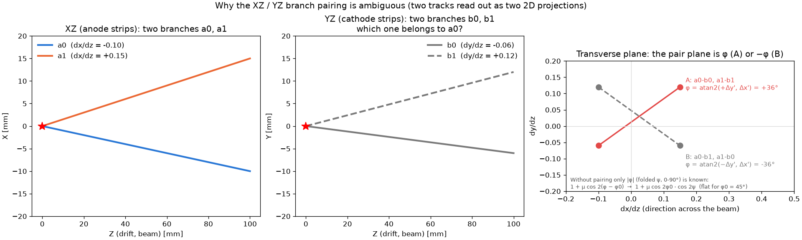

実際、45° 偏光のデータを折り返した ψ で見ると平ら（μ = +0.058 ± 0.043、1.3σ。3枚目のパネル）で、偏光が見えない。

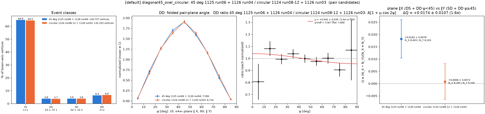

### シンチのヒットでは決められなかった

2本の直線を散乱点からシンチの面まで延ばし、HA のヒットのピクセル位置に近い組み方を選ぶ方法を試した（水平 run07 の DD 2,033 件）。
ヒットを別のイベントのものに入れ替えても（シャッフル）、近い方の交点との距離の中央値は 16.8 mm → 19.2 mm とほとんど変わらず、
組み方の情報はほとんど無かった。理由:
- e+ も e- も前方に飛ぶので、どのイベントの直線もシンチの同じあたりに当たり、HA のヒットもそこに集まる。
- 散乱点が遠いと、40 mm で決めた向きを最大 30 cm 延ばすので、多重散乱（3 気圧 Ar、約 3 MeV）と延長の誤差で 20 mm 以上ずれる。
  近いと、2本がまだ離れておらず、A と B の交点が数 mm しか違わない。どの Z でも「A と B の差」と「ずれ」が同じくらい。
- ヒットが e+・e- とは限らない（対消滅の 511 keV、ほかの γ）。ピクセル位置の較正（特に LG）も暫定。

枝を下流まで追えるようになったので、追った枝の先端から延ばせば改善する可能性がある（未実施）。

### TPC だけで決める方法（`pipeline/branch_pairing.py`）

**① 枝を下流まで追う**（stage2、XZ と YZ で別々。対象は両方の投影で2本 fit が成立したイベント）
1. 散乱点から `pairing.context_mm`（250 mm）以内、散乱点より 3 mm 以上下流のストリップを使う。1点 = あるクロックで鳴った1本のストリップ。
   出発点は stage2 の2本 fit の直線（散乱点から `scan.radius_mm` = 40 mm 以内で決めたもの）。
2. 下流へクロックごとに、そのクロックのストリップを、`cluster_gap_mm`（1 mm）より離れたところで「塊」に分ける。
3. 各枝の予測位置から `window_mm`（2.4 mm）以内の塊を、その枝に割り当てる。1つの塊は1本の枝にだけ割り当て、
   予測位置に近い（枝, 塊）の組から順に決める（2本が同じ塊を取り合って、同じ飛跡に乗ってしまうのを防ぐ）。
4. 予測位置は、その枝の直近 `refit_length_mm`（30 mm）の塊の中心（塊のストリップの位置の平均）に直線を当てて延ばす（中心が5個未満なら出発点の直線）。
   飛跡が少し曲がっても追えるように、散乱点を通る条件は使わない（`branch_pairing.predict`）。
   - 「直近 30 mm」は **Z（ドリフト方向）の幅**で、円ではない。その枝に割り当てた中心の列 (dz, t) のうち、
     dz >= dz_最後 − 30 mm のものを使う。横方向（X または Y）の距離は条件に入らない。
   - 直線は t = 傾き × dz + 切片 で、t 方向のずれを最小にする普通の最小二乗（`np.polyfit`。直線までの垂直距離ではない）。
   - 対生成の枝は前方に飛ぶので Z の 30 mm は飛跡に沿ってもほぼ 30 mm だが、傾きの大きい飛跡（例: 45°）では
     飛跡に沿って約 42 mm になる。
   - ほかの範囲との違い: `scan.radius_mm`（40 mm、出発点の2本 fit）と `pairing.context_mm`（250 mm、枝を追う範囲）は
     投影の平面での円 √(dz² + t²) <= 半径。`refit_length_mm` だけが Z 方向の帯。

     図（`make_cluster_figure.py` が塊の図と一緒に作る。水平 1124 run06 event 1181 の XZ）:

     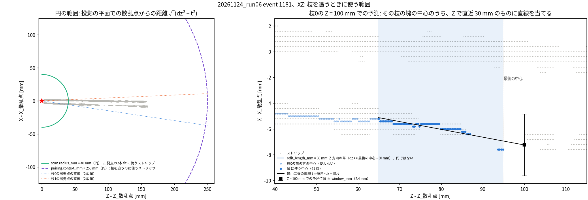

     - 左: 円の範囲。緑の実線が `scan.radius_mm` = 40 mm（出発点の2本 fit に使うストリップ）、紫の破線が
       `pairing.context_mm` = 250 mm（枝を追うのに使うストリップ）。点線は出発点の直線（散乱点を通る2本 fit）。
       このイベントでは枝0の出発点の直線（青の点線）が実際の飛跡より急で、Z が大きくなるほど飛跡から離れていく。
       出発点の直線のまま延ばすと枝を見失うので、追いながら予測を更新している。
     - 右: Z = 100 mm での枝0 の予測。青い点がこれまで枝0 に割り当てた塊の中心。最後の中心（Z ≈ 95 mm）から 30 mm 手前までの
       Z の帯（薄い青の帯、Z = 65〜95 mm）に入る濃い青の中心（61 個）だけに直線（黒）を当て、Z = 100 mm での位置（黒の四角）を
       予測する。縦の棒が ± `window_mm`（2.4 mm）で、この中の塊を枝0 に割り当てる。帯より前の薄い青の中心は使わない。
       帯の範囲は Z だけで決まり、横方向の位置は関係しない。
5. 2本の予測位置の差が `shared_mm`（4 mm）未満のクロックは、どちらの枝の塊か分からないので、位置を更新せず、
   ストリップ数も記録せず、終わりの判定もしない（出発点の直線のまま延ばす）。散乱点の近くなど。
   - ここで塊を1本にだけ渡すと、もう1本が何も拾えずすぐ「終わり」になる。両方で共有すると、2本が同じ飛跡に乗って分かれなくなる。
     どちらも試して失敗したので、この扱いにした。
6. 枝の塊が `gap_mm`（10 mm）続けて無ければ、その枝は終わり。最後に塊があった Z を「枝の端」とする。
7. 記録するもの: 各枝の「クロック番号ごとのストリップ数（割り当てた塊の大きさ）」と「端の Z」。
   クロック番号は dz / ドリフト速度を丸めたもので、XZ と YZ で同じ番号になる。

*塊とは*（図: `make_cluster_figure.py`、水平 1124 run06 event 1181 の XZ）

TPC の raw は「どのクロックに、どのストリップ（0.4 mm 間隔）が鳴ったか」だけを持っている。1本の飛跡は、1つのクロックで
隣り合う数本のストリップを鳴らす（電子の雲の広がりと飛跡の傾きの分）。そこで1クロックのストリップを位置の順に並べ、
間が `cluster_gap_mm`（1 mm、ストリップ約2本分）より空いたところで切って「塊」にする。2本の枝が離れていれば、
1クロックに塊が2つ（たまにノイズや δ 線でそれ以上）できる。
塊の「中心」は、塊に入ったストリップの位置の平均（raw に電荷が無いので重みは付けない）。

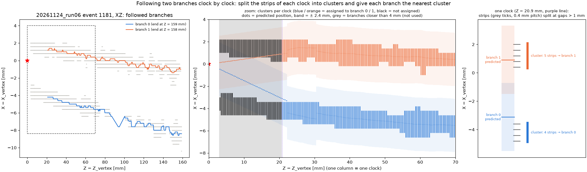

- **右（1クロックの切り出し、Z = 20.9 mm）**: 灰色の目盛りが鳴ったストリップ。上の5本と下の4本の間が 1 mm より空いているので、
  2つの塊に分かれる。各枝の予測位置（横線）と ± 2.4 mm の窓（薄い帯）に入る塊を、その枝に割り当てる
  （上の塊 → 枝1、下の塊 → 枝0）。塊の大きさ（ストリップ数: 5 本と 4 本）が、②で使う「そのクロックのストリップ数」。
- **中（散乱点の近くを拡大）**: 縦の線1本が1クロックの1つの塊。青・橙は枝0・枝1に割り当てた塊、黒は割り当てなかった塊。
  点線は各枝の予測位置、薄い帯は ± 2.4 mm の窓。
  - 灰色の網かけ（Z < 21 mm）は、2本の予測位置の差が `shared_mm`（4 mm）より小さいクロック。ここでは塊を割り当てず
    （黒）、ストリップ数も記録しない。予測位置は出発点の2本 fit の直線（散乱点を通る）のまま延ばす。
  - 網かけを抜けると、各枝は自分の窓に入る塊を毎クロック拾い、その中心から次の予測位置を出す（直近 30 mm の中心に直線）。
- **左（全体）**: 色の線が割り当てた塊の中心の道すじ。枝0（青）は Z ≈ 90〜100 mm で少し曲がっているが、直近 30 mm の
  中心で予測するので追い続けられている。2本とも Z ≈ 160 mm まで追えた（端の Z = 158・159 mm）。

*この例で分かる弱点*: このイベントでは、実際の2本は散乱点の近く（Z = 3 mm）ですでに約 5 mm 離れていて塊も2つに分かれているが、
予測位置（散乱点を通る出発点の直線）どうしは近いので、Z < 21 mm を「重なり」として使っていない。散乱点の位置の推定が
実際の分かれ目からずれているためと考えられる。重なりの判定に、予測位置ではなく実際の塊の数（1クロックに塊が2つあるか）を使えば、
使えるクロックが増える可能性がある（未実施）。

**② クロックごとのストリップ数の相関**

*4つの相関と2通りの組み方*

XZ の枝（a0, a1）と YZ の枝（b0, b1）の「1対1の組」は 2 × 2 = 4 通りあり、それぞれで相関 r_ij を出す。

|  | b0 | b1 |
|---|---|---|
| a0 | r00 | r01 |
| a1 | r10 | r11 |

組み方は2通りしかない（a0 の相手が決まれば a1 の相手も決まる）。4つの相関のうち2つずつが、それぞれの組み方に対応する。

| 組み方 | 使う相関 | 組み方の相関 |
|---|---|---|
| A（a0-b0、a1-b1） | r00、r11 | r_A = (r00 + r11) / 2 |
| B（a0-b1、a1-b0） | r01、r10 | r_B = (r01 + r10) / 2 |

原理的には a0 についての r00 と r01 を比べるだけでも決まる。a1 についての2つも同じ問いの答えなので、平均して揺らぎを抑えている。
片方の組の相関が計算できなければ、計算できた方の値だけを使う。r_A − r_B は「A の方が B よりどれだけ相関が大きいか」で、
正なら A、負なら B が有力（④で |r_A − r_B| >= 0.1 なら決める）。

*相関係数の式*（Pearson、`branch_pairing.correlation`、`np.corrcoef`）

XZ の枝 ai と YZ の枝 bj の両方に記録があるクロック t = 1, …, n を使う（2本が重なるクロックは除く。n >= `min_clocks` = 15 のときだけ）。
x_t = その時刻に ai に割り当てた塊のストリップ数、y_t = bj に割り当てた塊のストリップ数として、

```
           Σ_t (x_t − x̄)(y_t − ȳ)
r_ij = ─────────────────────────────────────────      x̄ = (1/n) Σ_t x_t,  ȳ = (1/n) Σ_t y_t
        √(Σ_t (x_t − x̄)²) · √(Σ_t (y_t − ȳ)²)
```

- 分子は「x が平均より多い時刻に、y も平均より多いか」を足し合わせたもの。一緒に増減すれば正、逆なら負、無関係なら 0 に近い。
- 分母でそれぞれの揺らぎの大きさで割るので −1〜+1。平均を引いているので、枝の傾きなどで XZ と YZ の本数の平均が違っても
  （例: XZ は平均 5 本、YZ は平均 3 本）影響しない。見ているのは時刻ごとの増減のそろい方だけ。
- x か y がすべての時刻で同じ値なら分母が 0 なので計算しない。

*具体的な値*

下の「実際のイベント」の図の3件:

| イベント | r00 | r11 | r01 | r10 | r_A | r_B | r_A − r_B | 判定 |
|---|---|---|---|---|---|---|---|---|
| 1124 run06 event 1001 | 0.56 | 0.83 | −0.16 | −0.23 | 0.70 | −0.19 | +0.89 | A |
| 1124 run06 event 1181 | −0.21 | −0.38 | 0.70 | 0.58 | −0.30 | 0.64 | −0.94 | B |
| 1124 run06 event 2193 | −0.12 | 0.42 | 0.83 | 0.41 | 0.15 | 0.62 | −0.47 | B |

全データ（水平・円偏光・45°・垂直の DD 18,179 件のうち、r_A と r_B の両方が計算できた 14,446 件、cut set `default`、`make_pairing_stats.py`）:

| | 平均 | 中央値 |
|---|---|---|
| 選んだ組み方の相関 max(r_A, r_B) | 0.634 | 0.678 |
| 選ばなかった組み方の相関 min(r_A, r_B) | −0.007 | −0.007 |
| \|r_A − r_B\| | — | 0.631 |

- |r_A − r_B| >= 0.1 で相関で決まったのは 13,689 件（両方が計算できたものの 95%、DD 全体の 75%）。A 6,758 件、B 6,931 件で偏りは無い。
- 選ばなかった組み方の相関は 0 のまわりに分布し、別のイベントの枝と組ませた場合（試作で −0.003）と同じ。
  正しい組み方だけが相関を持つことを示している。
- 右の r_A − r_B の分布は ±0.6 付近に2つの山があり、0 付近（決められない）は少ない。

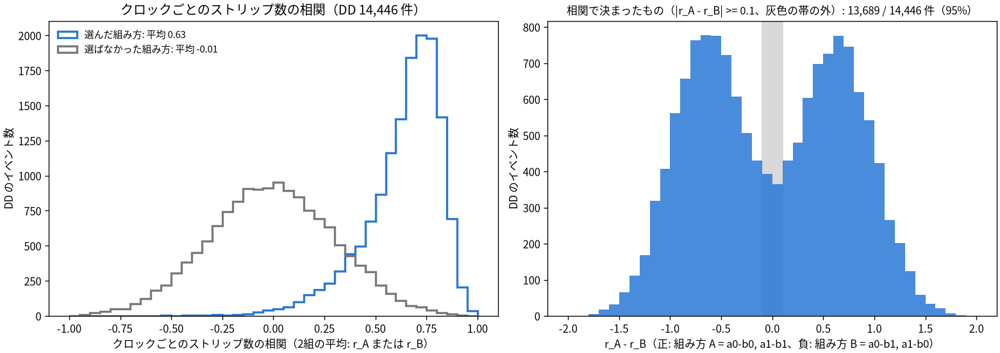

- 考え方: 同じ粒子なら、同じクロックで同じ電子の雲を XZ と YZ の両方で見ている。uPIC では1つのピクセルのなだれが
  アノードとカソードの両方に信号を出すので、電離の揺らぎ（δ 線や電荷の塊）で電荷が多いクロックでは、両方の投影で
  鳴るストリップが一緒に増える。別の粒子どうしなら相関は無い。raw には電荷の値が無いので、ストリップ数を電荷の代わりに使う。
  2次元ストリップの読み出しで、X と Y を電荷の相関で対応づける方法の代わり。

**③ 枝の端の Z**
- 組み方ごとに、XZ と YZ の対応する枝の端の Z の差を足す。
  A: |端(a0) − 端(b0)| + |端(a1) − 端(b1)|、B: |端(a0) − 端(b1)| + |端(a1) − 端(b0)|。
- 考え方: e+ と e- は止まる位置や TPC から出る位置が違うので、同じ粒子なら XZ と YZ で同じ Z で終わる。

**実際のイベント**（stage5 の `<run>_DD_pairing_<skip>.png`、水平 run06。`event_display.pairing_count` 件）

1行が1イベント。左が XZ、中が YZ で、灰色の点がストリップ、色の線が各枝に割り当てた塊の中心（枝を追った道すじ）。
決めた組み方で同じ粒子になる XZ と YZ の枝を同じ色にしている。右はクロックごとのストリップ数で、実線が XZ の枝、
点線がそれと組んだ YZ の枝。同じ色の実線と点線が一緒に上下していれば、同じ粒子を見ている。
- 1行目（event 1001）: r00 = 0.56、r11 = 0.83 に対し r01・r10 は負なので A。XZ の枝 a1 は約 75 mm で途切れている
  （灰色の点はその先も続いているので、枝を見失った例）。このように端の Z はずれることがあるので、相関を優先している。
- 2行目（event 1181）: r01 = 0.70、r10 = 0.58 で B。右の図で、実線と点線の山と谷がそろっているのが分かる。
- 3行目（event 2193）: r01 = 0.83 で B。散乱点の近く（Z < 25 mm）でストリップ数が大きく増える塊が両方の投影に出ている。

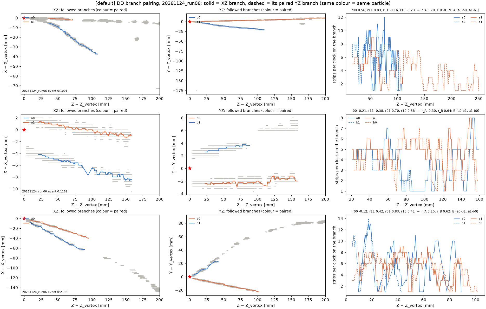

**④ 決め方**（stage3、`branch_pairing.decide`）
1. |r_A − r_B| >= `min_r_difference`（0.1）なら、相関の大きい方。
2. そうでなく、③の A と B の値の差が `min_end_difference_mm`（20 mm）以上なら、端の Z の差が小さい方。
3. どちらでもなければ「決められない」とし、φ_pair の解析には使わない。

stage3 の出力（`<sample>.npz`）: `pairing`（+1 = A、−1 = B、0 = 決められない）、`pairing_method`（correlation / end_z / undecided）、
`phi_pair`（決められたものだけ、0〜180°）。stage4 は比較ごとに φ_pair のヒストグラム（`analysis.pair.phi_bins`、既定 12）の比を
A [1 + μ cos 2(φ − φ0)]（φ0 も自由）で fit し、`pair_phi.png`・`pair_phi.json`・`summary.md` に出す。
有意度は平らな線との Δχ²（2自由度: μ と φ0）。

### 確かめたこと

**相関が組み方の情報を持っているか**（試作のスクリプト、水平の DD）

| | run06（181 件） | run07（2,033 件） |
|---|---|---|
| 相関を計算できたイベント | 138（76%） | — |
| 相関の平均: 良い方の組み方 / 悪い方 | 0.64 / 0.00 | 0.635 / −0.004 |
| 相関の平均: 別のイベントの枝と組ませた場合（シャッフル） | −0.02 | −0.003 |
| ② 相関と ③ 端の Z の判定の一致（両方で決められたもの） | 80 / 85（94%） | 888 / 980（91%） |

- 良い方の組み方だけ相関が大きく、悪い方はシャッフルと同じ 0。偶然では説明できない。
- 2つの方法は別の情報（電離の揺らぎと終わる位置）を使っていて、偶然なら一致率は 50%。それぞれの正しく選べた割合を p1, p2 とすると
  一致率は p1 p2 + (1 − p1)(1 − p2) なので、両方とも約 95% 以上と見積もれる（2つが独立という仮定つき）。
- A と B はほぼ半々に選ばれている（片方への偏りは無い）。

**偏光の向き**（全データ、cut set `default`、組み方を決めた DD の φ_pair）

| 比較 | 組み方が決まった DD（分子 / 分母） | μ | φ0 | 有意度 |
|---|---|---|---|---|
| 水平 ÷ 円偏光 | 3,339 / 3,382 | 0.239 ± 0.045 | 178 ± 3°（≈ 0°、面 ∥ X） | 4.8σ |
| 45° ÷ 円偏光 | 3,210 / 3,382 | 0.177 ± 0.031 | 143 ± 7°（≈ −37°） | 5.5σ |
| 垂直 ÷ 円偏光 | — | 0.147 ± 0.040 | 99 ± 5°（面 ∥ Y） | 3.4σ |
| 水平 ÷ 垂直 | — | 0.376 ± 0.040 | 3 ± 2° | 8.8σ |
| 水平同士（run00-05 ÷ run06-07） | — | 0.070 ± 0.062 | — | 0.7σ（平ら） |
| 垂直同士（run00 ÷ run01-05） | — | 0.063 ± 0.045 | — | 1.1σ（平ら） |

- 45° は、折り返した ψ では平ら（μ = +0.058 ± 0.043、1.3σ）だったが、組み方を決めると 5.5σ で見える。
  45° と 135° のあたり（DD のイベントが一番多い向き）で、45° と円偏光の多い少ないが入れ替わっている。
  左の分布は、DD のアクセプタンスのため 45° と 135° に山、0°・90°・180° の近くに谷がある（両方の投影で2本に見える必要があるため）。

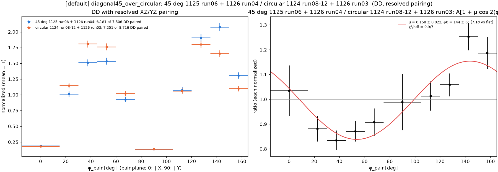

- 水平は φ0 = 178°（≈ 0°、面 ∥ X）で、折り返した ψ の結果と同じ向き。

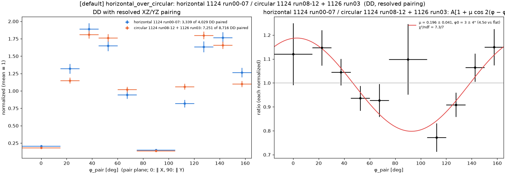

- 垂直は φ0 = 99°（面 ∥ Y）。

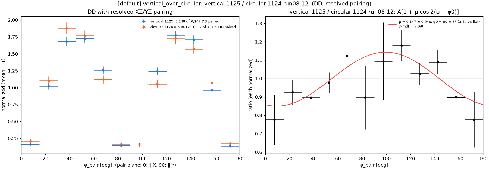

- 3つの線偏光の向き（φ0）を、検出器から見た偏光の向きと比べる（45° のデータは、検出器から見ると −45° の偏光）。

  | 偏光（検出器から見た向き） | 予想の φ0 | 測った φ0 | 差 |
  |---|---|---|---|
  | 水平 | 0° | −2 ± 3° | −2 ± 3° |
  | 45° のデータ（検出器から −45°） | −45°（= 135°） | −37 ± 7°（= 143°） | +8 ± 7°（1.1σ） |
  | 垂直 | 90° | 99 ± 5° | +9 ± 5°（1.8σ） |

  3つとも 2σ 以内で予想どおり。検出器と偏光の向きの共通のずれ δ を3つの差の重み付き平均で出すと δ = +1.8 ± 2.4°（0 と矛盾しない）、
  δ のまわりのばらつきは χ² = 4.5 / 2 自由度（p ≈ 0.11）。偏光の向きを約 ±2.4° で正しく測れている。
- 組み方を間違えると φ → −φ になるので、45° の sin 2φ は (2p − 1) 倍に薄まる。45° の μ（0.18）が水平の μ（0.24）と
  同じくらいなので p は高いと考えられる（2つのデータの偏光度が同じなどの仮定つき）。
- DD のうち組み方が決まったのは約 83%（相関で約 75%、端の Z で約 8%）。

### 注意・未確認のこと

- パラメータ（2.4 mm、4 mm、10 mm、15 クロック、0.1、20 mm など）は試しながら決めた値で、最適化していない。
- 正しく選べた割合 p は、2つの方法の一致率と 45° の μ からの間接的な見積もり。正解のあるシミュレーションで確かめる必要がある。
- 2本が交差するイベント（片方の投影で予測位置が入れ替わる）は、③の端の対応や②の割り当てが崩れる可能性がある（未確認）。
- 「確かめたこと」の相関・一致率の表は、試作のスクリプト（リポジトリには入れていない）で出したもの。パイプラインの実装（`branch_pairing.py`）は
  同じ手順を整理したもので、シャッフルの比較と一致率の集計はまだパイプラインに入っていない。
